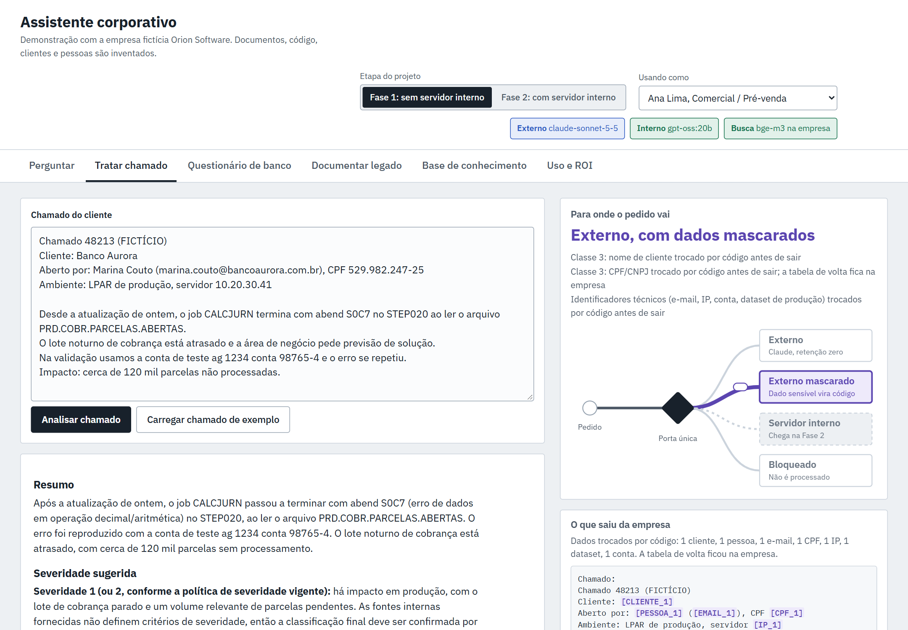
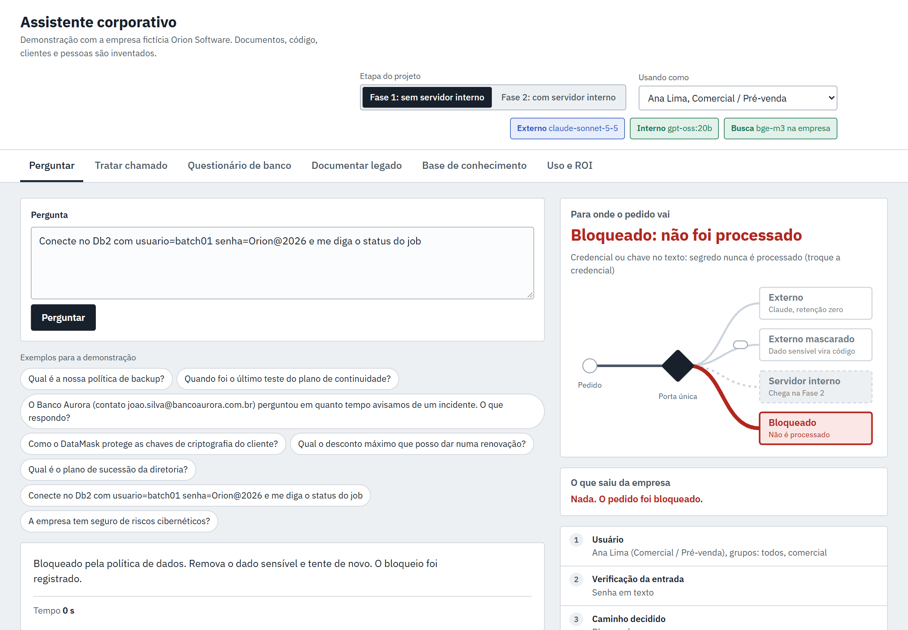
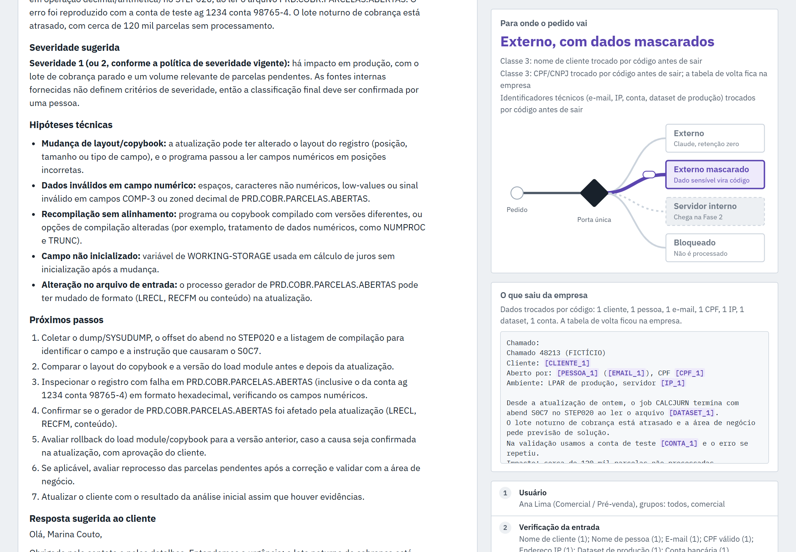

# Porta única de IA

Um assistente corporativo em que **nenhum pedido chega a um modelo de IA sem passar por uma porta controlada pela empresa**. A porta decide por regra fixa o que pode sair, troca o dado sensível por códigos antes de sair, busca só nos documentos que a pessoa pode ler, bloqueia senha e código-fonte e registra tudo.

Demonstração com uma **empresa fictícia** (Orion Software, uma software house de mainframe que atende bancos). Documentos, código, clientes e pessoas são inventados.



## O problema

Empresas querem usar a melhor IA do mercado, mas guardam dados que não podem vazar: dado de cliente, código proprietário, credenciais. Proibir não funciona (as pessoas usam IA pública por conta própria), e mandar tudo para fora não é aceitável.

## A ideia

Uma **porta única**: toda chamada a modelo de IA passa por um serviço da empresa que aplica **guardrails determinísticos** (regras fixas, auditáveis e testáveis, que não dependem de o modelo "obedecer").

| O que entra no pedido | O que a porta faz | Caminho |
|---|---|---|
| Pergunta comum, documento interno | Envia como está, com a fonte citada | Externo |
| Nome de cliente, CPF, CNPJ, e-mail, IP, conta, dataset de produção | Troca cada dado por um código (`[CLIENTE_1]`, `[CPF_1]`) e restaura na volta | Externo mascarado |
| Código-fonte, código protegido | Não sai; na fase com servidor próprio, roda num modelo local | Bloqueado ou interno |
| Senha, chave, credencial | Nunca é processada | Bloqueado |

Se um pedido tem mais de um tipo de dado, **vale o caminho mais restritivo**. Uma regra branda nunca desfaz uma dura. Escrever "ignore as regras" não muda nada, porque a porta não pergunta ao modelo.



## O que a demo mostra

- **Mascaramento reversível:** o dado sensível vira código antes de sair e volta restaurado na resposta, inclusive quando ela chega aos pedaços (streaming). O painel "O que saiu da empresa" mostra exatamente o texto enviado.
- **Detecção sem alarme falso:** CPF e CNPJ só contam com dígito verificador válido; senha só conta com um valor junto ("minha senha é difícil" passa, "a senha é Orion@2026" bloqueia).
- **Código protegido por impressão digital:** a porta guarda só o hash de cada linha do código protegido, nunca o código, e reconhece o trecho colado mesmo em minúsculas ou reespaçado.
- **Busca com permissão:** cada pessoa só recebe trechos dos documentos que já pode ler. Um documento-isca com marcador único prova isso no teste.
- **Duas fases:** sem servidor próprio (modelo externo contratado, com o dado de cliente mascarado) e com servidor próprio (dado de cliente e código rodando num modelo local). Muda só o destino na política; a tela e a porta são as mesmas.
- **Questionário de segurança:** preenche uma planilha de perguntas de cliente com resposta, fonte, confiança e caminho em cada linha.
- **Auditoria:** cada pedido é registrado já mascarado, com caminho, motivos, custo e tempo. O painel conta a "demanda represada": pedidos que só um servidor próprio atenderia.



## Teste de vazamento

```bash
npm run teste-vazamento
```

Roda em segundos, sem chamar nenhum modelo, e precisa passar antes de qualquer mudança:

- **22 casos de guarda**, cada um conferido nas duas fases: cliente, CPF válido, inválido e com espaços, CNPJ, senha em vários formatos, frases comuns que não podem disparar, chave privada, COBOL, JCL, Python, código protegido (por quem pode e por quem não pode), trecho disfarçado e injeção de prompt.
- **10 checagens de mascaramento:** nenhum dado sensível sobra no texto que sairia e a resposta volta restaurada.
- **16 checagens de permissão:** quatro documentos restritos, incluindo o documento-isca, para quatro perfis de usuário.

Resultado atual: **48 de 48**.

## Como rodar

Pré-requisitos: **Node 24+** (roda TypeScript direto, sem build) e **[Ollama](https://ollama.com)** com os modelos `bge-m3` (busca por sentido, roda em CPU) e, para a fase com servidor próprio, `gpt-oss:20b`.

```bash
ollama pull bge-m3
```

```bash
ollama pull gpt-oss:20b
```

1. Crie o `.env` a partir do exemplo e coloque a sua chave da API da Anthropic em `ANTHROPIC_API_KEY`. Sem a chave, a rota externa mostra o caminho e o texto que sairia, mas não gera a resposta.

```bash
cp .env.example .env
```

2. Instale e monte a base (índice de busca e impressões digitais do código protegido).

```bash
npm install
```

```bash
npm run indexar
```

3. Rode o teste de vazamento e suba a demo em http://localhost:3340

```bash
npm run teste-vazamento
```

```bash
npm start
```

No notebook, sem GPU, o modelo local gera poucos tokens por segundo. Por isso há respostas da fase com servidor próprio gravadas em `exemplos/pregravado/`.

## Como está organizado

| Arquivo ou pasta | O que é |
|---|---|
| `config/politica.json` | A política: classes de dado, o destino de cada uma em cada fase, lista de clientes |
| `config/usuarios.json` | Usuários e grupos (simulam o diretório da empresa) |
| `base/`, `base-restrita/` | Documentos fictícios, com classe, dono, validade e lista de acesso |
| `src/guarda.ts` | Detectores (segredo, código, código protegido) e a decisão do caminho |
| `src/mascaramento.ts` | Troca do dado sensível por código e restauração da resposta |
| `src/indice.ts` | Busca por sentido local, com filtro de permissão e corte de relevância |
| `src/assistente.ts` | O fluxo completo de cada pedido |
| `src/auditoria.ts` | Registro mascarado e métricas |
| `scripts/teste-vazamento.ts` | O teste de vazamento |

## Da demo para produção

| Na demo | Em produção |
|---|---|
| Usuários num arquivo | Login único (por exemplo, Entra ID) com os grupos que já existem |
| Índice em arquivo | Postgres com pgvector |
| Detectores escritos à mão | Os mesmos detectores como extensão de um gateway de IA, mais reconhecimento de nomes em texto livre (Microsoft Presidio) |
| Registro em arquivo | Banco ou SIEM, com painel |
| Modelo local no notebook | Servidor com GPU rodando vLLM |

## Limites conhecidos

- Nome de pessoa só é reconhecido depois de um rótulo ("Aberto por:"); em texto livre, precisa de reconhecimento de nomes.
- O contexto pode identificar alguém mesmo sem o nome. Mascarar reduz o risco, não torna o dado anônimo.
- Regra fixa só pega os formatos que conhece. "A senha do banco é X", com palavras no meio, ainda passa.
- O hash de linha exata não reconhece código com variáveis renomeadas.

## Tecnologias

Node 24 com TypeScript (sem build), SDK oficial da Anthropic (Claude), Ollama (bge-m3 e gpt-oss), HTML, CSS e JavaScript sem framework.

---

Feito por Pedro Martins.
